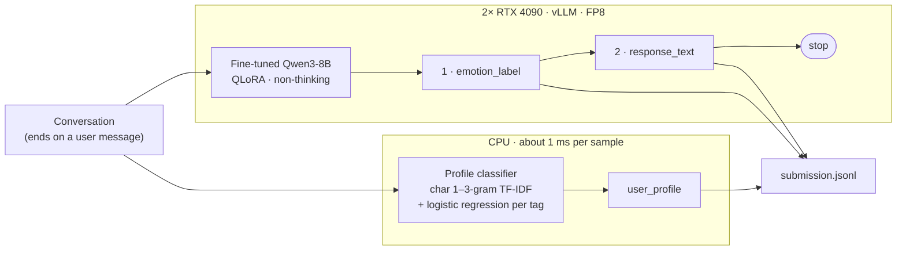

# Qwenpathy

**An offline emotional-companion dialogue model built on Qwen3-8B.** It reads a Chinese conversation, decides how the user feels, replies with empathy and keeps a profile of who the user is, all on two consumer GPUs with no internet access.


**[Technical report (PDF)](docs/technical-report.pdf)** · [Experiments](experiments/README.md) · [Submission log](LOG.md) · [How-to](docs/how-to.md)

Our entry for the **2026 动感地带AI+高校创智计划** (2026 M-Zone AI+ University Innovation Program, run by China Mobile, Migu and Nankai University), technical track, Topic 2: **数字人综合情感陪伴对话模型**, a digital-human emotional-companion dialogue model.

> **简介：** Qwenpathy 是西北工业大学 Qwenpathy 队参加 2026 动感地带AI+高校创智计划技术赛道赛题二（数字人综合情感陪伴对话模型）的参赛方案。系统基于 QLoRA 微调的 Qwen3-8B，完全离线运行：模型先判断用户情绪（16 类），再生成共情回复；用户画像由一个独立的 CPU 分类器给出。完整技术文档见 [docs/technical-report.pdf](docs/technical-report.pdf)，全部 30 个实验的记录见 [experiments/](experiments/README.md)。

---

## The task

Each test sample is a Chinese multi-turn conversation that ends on a user message. The system writes one JSON line per sample:

| Output | What it is | Points |
|---|---|---|
| `emotion_label` | Emotion of the latest user message, 1 of 16 labels | 25 · accuracy |
| `response_text` | The next assistant reply, in Chinese | 20 · BLEU-4, ROUGE-L, BERTScore |
| `user_profile` | Personality traits, interests and style: 33 tags in 3 fields | 15 · exact match |
| `memory_refs` | Memory ids (the test set has no memory bank, so always `[]`) | — |
| Latency | Mean time per sample over the first 100 samples | 10 |
| Expert review | Integrity, code quality, platform records | 30 |

The organisers run `bash /root/participant/start.sh TEST_FILE RESULT_DIR` inside their Docker image, offline, on two 24 GB GPUs. External APIs are not allowed.

## Results

All five submissions, re-scored on the same 600 validation points (latency is the mean over the first 100 points on the contest hardware):

| # | Date | What changed | Emotion | Profile exact | ROUGE-L | Latency |
|---|---|---|---|---|---|---|
| 1 | Oct 4 | Base Qwen3-8B, official prompt | 0.48¹ | — | 0.173¹ | 1.41 s |
| 2 | Oct 9 | QLoRA fine-tune, V1.8 prompt | 0.790 | 0.534 | 0.294 | 1.55 s |
| 3 | Oct 16 | FP8 weights + CPU profile classifier blended with the model's tags | 0.787 | 0.562 | 0.294 | 1.14 s |
| 4 | Nov 10 | Stop after the reply; profile from the classifier alone, tuned for exact match | 0.788 | 0.652² | 0.295 | 0.92 s |
| **5** | **Nov 10** | **Decide-first retrain: emotion before reply, rare classes repeated (V4)** | **0.793** | **0.652²** | **0.296** | **0.89 s** |

¹ Submission #1 was checked on 50 points only. ² Thresholds were fitted on these 600 points; the 5-fold cross-validated estimate is 0.647. Official test scores have not been published yet.

For reference, always answering *anxiety* scores 0.325 on emotion, and an all-empty profile scores 0.610 per field.

## How it works

Two readers and one writer. A small CPU classifier decides the slow-moving profile. The fine-tuned language model decides the emotion first and then writes the reply.



1. **Prompt.** One system prompt (V1.8) is shared by training and inference, imported from the same file so the two can never drift apart.
2. **Generation.** vLLM serves the merged model in FP8 with tensor parallelism over both GPUs, greedy decoding and thinking disabled. The model writes `emotion_label` first, then `response_text`.
3. **Early stop.** Generation stops where the profile would begin, which removes 41% of the generated characters. A cut answer that lacks a label or a reply is regenerated in full; this fired on 0 of 600 validation points.
4. **Profile.** A character n-gram classifier over the user's messages, trained on the official training data only, keeps a tag when its probability passes a per-field threshold tuned for exact match.
5. **Output.** One JSON line per input, in input order.

## What we learned

- **Fine-tuning was the only lever on emotion.** Twelve prompt versions moved nothing beyond noise. QLoRA on the 14,942 official training points raised emotion accuracy from 0.58 to 0.82 on 100 held-out points.
- **The profile is a trait, not a state.** Consecutive points of one conversation share the same gold profile 72% of the time. A 1 ms classifier tuned for the scored metric beats the 8B model on it (0.652 against 0.534), so the model no longer writes the profile at all.
- **Emotion hits a ceiling near 0.79, set by the labels.** Four model versions land between 0.787 and 0.793. The remaining errors sit on "worried, then relieved" messages, where the training labels themselves split: anxiety in 38% of cases, relaxed in 24%.
- **Every decision had a rule written before the run.** Each candidate was installed by a script that backed up the submitted files and restored them when its pass rule failed. Thirty numbered experiments are logged, the failed ones included.

## Quick start

**Run the entry exactly as the organisers do** (Linux, vLLM 0.19, two GPUs; merged model weights in `participant/model/`, which is not in git):

```bash
bash participant/start.sh data/val_input_n100.jsonl results/
# writes results/submission.jsonl, results/performance_report.json and results/vllm_server.log
```

`participant/configs/inference_config.json` is the base configuration. To reproduce the final entry, add these four keys (FP8 serving, the CPU profile classifier, early stop and the exact-match thresholds):

```json
{
  "vllm_quantization": "fp8",
  "profile_classifier": "profile_clf",
  "stop_after_emotion": true,
  "profile_blend": {"personality_traits": [0.0, 0.45], "interests": [0.0, 0.30], "style": [0.0, 0.35]}
}
```

**Check the format and score it** (Python 3.10+, no GPU needed):

```bash
python scripts/validate.py results/submission.jsonl --input data/val_input_n100.jsonl
python scripts/eval.py results/submission.jsonl data/val_gold_n100.jsonl --history ""
python scripts/eval_600.py --check     # re-scores submissions #2 to #4 from saved model answers on 600 points
python tests/run_tests.py              # tests for the validator and the scorer
```

**Train.** The recipe is LLaMA-Factory 0.9.5, LoRA rank 16 / alpha 32 on all linear layers of a 4-bit base, 1 epoch, learning rate 1e-4 with cosine decay, global batch 8 on two RTX 4090 cards (about 2 h 10 min). The data builders are `train/build_sft.py` and `train/make_v4_data.py`; the configs are in [`experiments/exp030-v4-decide-first/configs/`](experiments/exp030-v4-decide-first/README.md).

## Repository layout

```
participant/        the submitted code: start.sh, run_inference.py, configs/, profile_clf/ (CPU classifier)
train/              training-data builders and checks
scripts/            validation, scoring, error analysis, one-command GPU sessions, install/restore scripts
tests/              offline tests, with a stub vLLM server that replays saved model answers
experiments/        one folder per experiment (EXP-001 to EXP-030): goal, set-up, results, decision
docs/               technical report, how-to, data format and statistics, evaluation design, latency, organiser answers
data/               only the fixed validation slices used for evaluation
outputs/            saved model answers on the 600 validation points, re-scored offline
LOG.md              submissions, compute spend and the experiment index
```

The contest data belongs to the organisers. Only the fixed evaluation slices are tracked here; model weights and the full data are not.

## Team

**Team Qwenpathy**, Northwestern Polytechnical University (西北工业大学), Xi'an, China

| Member | Role |
|---|---|
| **Ismail FAOUZI** | Captain · training lead (QLoRA) · Migu platform and infrastructure · classification and prompt |
| Zakaria Assaban | Data: validation converter, dataset statistics |
| Yahya El Amrani | Evaluation: validation, scoring and analysis scripts |
| Ismail AKAMI | Prompt experiments and training support |

**Faculty advisor:** Prof. Wang Fang

We thank the organisers for answering our questions in the technical-track group and for the additional compute. We used an AI assistant (Claude, by Anthropic) to help write scripts, analyse results and draft documentation. Every experiment was run by the team on the contest platform, and every number here comes from logged output in this repository.

## Citation

```bibtex
@techreport{qwenpathy2026,
  title       = {An Emotional-Companion Dialogue System on Qwen3-8B: Fine-Tuning,
                 a Separate Profile Reader and Decide-First Decoding},
  author      = {Faouzi, Ismail and Assaban, Zakaria and El Amrani, Yahya and Akami, Ismail},
  institution = {Northwestern Polytechnical University},
  year        = {2026},
  note        = {Technical report, first round of the 2026 M-Zone AI+ University Innovation Program, technical track, Topic 2}
}
```

<details>
<summary><b>For team members: setup and common traps</b></summary>

New here? Read [docs/how-to.md](docs/how-to.md) (every tool, with copy-paste commands), then [docs/team-work.md](docs/team-work.md) and [TASKS.md](TASKS.md). Team rules are in [CONTRIBUTING.md](CONTRIBUTING.md).

**Five-minute setup on Windows** (Python 3.10+ and git; the API path needs no PyTorch):

```powershell
git clone https://github.com/IsemIsCold/Qwenpathy.git
cd Qwenpathy
# put the data/*.jsonl files in place (docs/how-to.md §1)
Set-ExecutionPolicy -Scope Process Bypass
. .\scripts\setup-api-env.ps1 -Participant "$PWD\participant"
python tests\run_tests.py        # should end with ALL TESTS PASSED
```

**Git in China: "Connection was reset".** Git does not use your VPN's system proxy on its own. Point it there (Clash Verge uses 7897, older Clash 7890), or turn on TUN mode:

```bash
git config --global http.proxy  http://127.0.0.1:7897
git config --global https.proxy http://127.0.0.1:7897
```

**Two Windows traps:**
- Never create JSONL with PowerShell `>`. It writes UTF-16 and breaks the Chinese text. Write files from Python with `encoding="utf-8"`.
- Never paste API keys in chats or commit them. Keys live in an environment variable for one terminal window only (the setup script does this).

</details>
