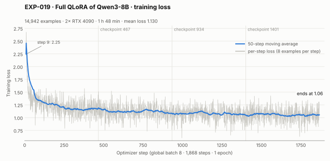

# EXP-019: Full QLoRA fine-tune of Qwen3-8B (T5–T7)

| | |
|---|---|
| **Date** | 2026-10-07 / 08 |
| **Author** | Ismail F. (data rebuild, Migu setup, pilot, full run, merge, eval) |
| **Goal** | Fine-tune Qwen3-8B on the training set with the frozen V1.8 prompt and beat V1.8 on **both** val slices (TASKS rule for submission #2). |
| **Status** | **Done. PASS.** The full model beats V1.8 and the pilot on every metric on n50 and n50b. T9 submission check PASS → **submitted as #2 on Oct 9.** |

## Setup

- **Base model:** Qwen3-8B (`/root/participant/model`), non-thinking.
- **Data:** `train/build_sft.py --max-reply-chars 350` → **14,942** training examples (`migu_train`). Val conversations excluded; checked by `train/check_sft.py` (PASS, cutoff 6144). Prompt = exactly the V1.8 `SYSTEM_PROMPT` + `conversation_text()` from `participant/run_inference.py`, so training and inference see identical inputs.
- **Method:** QLoRA. 4-bit NF4 base (bitsandbytes), LoRA r=16, α=32, dropout 0.05, on all linear layers (43.6M trainable params, 0.53%). lr 1e-4 cosine, warmup 3%, 1 epoch, `cutoff_len 6144`, bf16.
- **Template:** `template: qwen3` + `enable_thinking: false`. This puts the empty `<think>\n\n</think>\n\n` block in the prompt exactly as vLLM does at inference; the loss is only on the JSON answer. (`qwen3_nothink` in LLaMA-Factory 0.9.5 does **not** add that block.)
- **Hardware:** Migu, 2× RTX 4090, DDP (global batch 8 = 1 per GPU × accum 4 × 2 GPUs, 1,868 steps). Training env = venv `/opt/train_venv` (LLaMA-Factory 0.9.5, torch 2.10.0+cu128); the submission env `conda_env` stays untouched.
- **Eval:** merged bf16 weights served by vLLM through the submission's own `start.sh` (TP2, greedy), scored with `scripts/eval.py`. Same path as the T4 baseline.

Exact configs: [configs/full.yaml](configs/full.yaml), [configs/merge_full.yaml](configs/merge_full.yaml), pilot [configs/pilot_ddp.yaml](configs/pilot_ddp.yaml).

### Commands (on Migu)

```bash
# train (2-GPU boot)
export PATH=/opt/train_venv/bin:$PATH        # torchrun shim -> the venv's python
FORCE_TORCHRUN=1 nohup llamafactory-cli train /mnt/storage/configs/full.yaml > /mnt/storage/runs/full.log 2>&1 &

# merge LoRA into bf16 weights (CPU) + use the base model's tokenizer files
llamafactory-cli export /mnt/storage/configs/merge_full.yaml
cd /root/merged/full
for f in tokenizer.json tokenizer_config.json vocab.json merges.txt generation_config.json added_tokens.json special_tokens_map.json; do
  if [ -f /root/participant/model/$f ]; then cp /root/participant/model/$f .; fi
done
rm -f chat_template.jinja

# eval (FRESH 2-GPU boot, see "What went wrong")
for s in n50 n50b; do
  env VLLM_MODEL_DIR=/root/merged/full VLLM_SERVED_MODEL_NAME=model bash /root/participant/start.sh /mnt/storage/val/val_input_$s.jsonl /mnt/storage/out/full_$s
  /opt/train_venv/bin/python /mnt/storage/scripts/eval.py /mnt/storage/out/full_$s/submission.jsonl /mnt/storage/val/val_gold_$s.jsonl --out /mnt/storage/out/full_$s/metrics.json --history "" --force
done
```

## Training

| | Pilot (T5) | **Full (T7)** |
|---|---|---|
| Examples | 2,000 (`migu_pilot2k`) | **14,942** (`migu_train`) |
| Steps (global batch 8) | 250 | 1,868 |
| Runtime | 892 s | **6,477 s (1 h 48 min)** |
| Throughput | 2.24 samples/s | 2.31 samples/s |
| Mean train loss | 1.315 | **1.130** |



Same data as a table ([train/trainer_log.jsonl](train/trainer_log.jsonl), mean per 200 steps):

| Steps | 1–200 | 201–400 | 401–600 | 601–800 | 801–1000 | 1001–1200 | 1201–1400 | 1401–1600 | 1601–1800 | 1801–1868 |
|---|---|---|---|---|---|---|---|---|---|---|
| Loss | 1.348 | 1.171 | 1.143 | 1.127 | 1.091 | 1.095 | 1.063 | 1.069 | 1.046 | 1.056 |

### Loss curve analysis

Mean loss per checkpoint quarter (each quarter = 467 steps ≈ 3,700 examples):

| Steps | 9–467 | 468–934 | 935–1401 | 1402–1868 |
|---|---|---|---|---|
| Mean loss | 1.21 | 1.118 | 1.078 | 1.057 |
| Drop vs previous quarter | – | −0.09 | −0.040 | −0.021 |
| Learning rate at the end of the quarter | 8.8e-5 | 5.3e-5 | 1.6e-5 | ≈0 |

**1. Three phases.**
- **Warm-up, steps 1–56** (3% of the run; the learning rate ramps from 0 to 1e-4). Loss falls fastest: 2.25 → about 1.37 (mean 1.76 over steps 9–30, 1.37 over steps 31–56).
- **Format learning, steps 56–200** (≈1,600 examples). Loss 1.34 → 1.26. The model learns the fixed parts of the answer: the JSON structure, the 16 emotion labels, the profile vocabulary. These tokens are almost free after this phase.
- **Content learning, steps 200–1868.** A slow, steady decline (−0.08 per 1,000 steps). This is the hard part: choosing the right emotion and writing a reply close to the gold one.

**2. Diminishing returns, partly by design.** Each quarter gains about half as much as the one before (−0.09, −0.04, −0.02). Part of the flattening is the cosine schedule: in the last quarter the learning rate drops from 1.6e-5 to zero, so the model is barely updating any more. The 50-step average is flat over the last ≈400 steps (1.049 → 1.055).

**3. No overfitting, and the curve tells us so directly.** This is **one epoch**: every step's loss is measured on 8 examples the model has never trained on, before it learns from them. So the training loss here is effectively a held-out loss on the training distribution. If the model were memorising instead of generalising, this loss would not keep falling on new examples. The val results (n50 / n50b, a different set of conversations) confirm it.

**4. The noise is normal and stable.** The per-step loss has a standard deviation of about 0.13 from step 30 to the end, and it does not grow. It comes from batch composition: each step sees only 8 conversations of very different length and difficulty. Only 6 of the 1,668 steps after step 200 go above 1.5, all before step 600, and none since. No spikes, no divergence: the learning rate (1e-4) and the LoRA setup are stable.

**5. Reproducible.** After 2,000 examples (step 250), the full run's mean loss is 1.319, the same as the pilot's 1.315 on its own 2,000 examples. The extra 12,942 examples then took the loss from ≈1.21 to ≈1.05, and emotion accuracy from 0.68 / 0.78 (pilot) to 0.80 / 0.86.

**6. Why the loss stops around 1.05 instead of going to zero.** Loss is the average cross-entropy per answer token. 1.055 means a perplexity of e^1.055 ≈ 2.9: on average the model hesitates between about 3 plausible next tokens. But the JSON keys and labels are close to zero loss by now, so almost all of the remaining loss is in the free-text reply, and a conversation has many good replies, not one. That part of the loss can never reach zero, and a lower training loss does not automatically mean better replies.

**What this means for the next run (P2):**
- **A second epoch is not worth 3.6 card-hours by itself.** The last quarter gained only 0.02, and in a second epoch the model would see each example again, so falling training loss would increasingly mean memorisation. Only the val slices could tell whether it helps.
- **Better use of a second run: targeted data** for the remaining errors (fear → anxiety, relaxed → anxiety), if the organisers allow generated data (EXP-017, Z4).
- **Measure what this run could not.** Add a validation loss on the 768-example dev set every ~250 steps (`val_size` / `eval_steps` in LLaMA-Factory; a few minutes per eval). Then a second epoch can be judged on held-out loss instead of by guessing.

Limitations: steps 1–8 are missing from the log (overwritten by the accidental second launch); there is no validation loss for this run (no dev eval was configured); the log has no gradient norms, only loss and learning rate.

## Results

Same harness, same val slices, greedy. V1.8 = the base model with the frozen prompt on Migu vLLM (T4).

| Metric | n50: V1.8 | n50: Pilot | **n50: Full** | n50b: V1.8 | n50b: Pilot | **n50b: Full** |
|---|---|---|---|---|---|---|
| Emotion accuracy (official) | 0.54 | 0.68 | **0.80** | 0.62 | 0.78 | **0.86** |
| Emotion macro-F1 | 0.238 | 0.339 | **0.510** | 0.336 | 0.449 | **0.597** |
| Profile micro-F1 (avg) | 0.352 | 0.410 | **0.489** | 0.323 | 0.340 | **0.477** |
| Profile exact match (avg) | 0.287 | 0.420 | **0.453** | 0.287 | 0.380 | **0.500** |
| ROUGE-L (char) | 0.174 | 0.237 | **0.269** | 0.197 | 0.259 | **0.293** |
| BLEU-4 (char) | 0.021 | 0.104 | **0.130** | 0.068 | 0.133 | **0.151** |
| Reply median, chars (gold) | 85 (146) | 128 | 150 (146) | 96 (100.5) | 110 | 106 (100.5) |
| Latency mean / median | 1.32 s | 1.62 s | 1.66 / 1.47 s | 1.52 s | 1.55 s | 1.50 / 1.30 s |
| Parse failures | 0 | 0 | 0 | 0 | 0 | 0 |

For reference, the DeepSeek V4.1-Flash "teacher" via API (EXP-017) scored 0.62 / 0.72 emotion accuracy and 0.231 / 0.249 ROUGE-L. The fine-tuned 8B model beats it on both.

**What improved most:**
- **Emotion:** +26 / +24 points over V1.8. Rare classes went from mostly wrong to mostly right: fear F1 1.00 on n50 (pilot 0.57), shame and disgust 1.00, sadness and loneliness 1.00 on n50b.
- **Replies:** ROUGE-L +0.10 and BLEU-4 ×6 / ×2 over V1.8. Reply length now matches the gold length (median 150 vs 146, 106 vs 100.5); the base model wrote replies that were too short.
- **Profile:** +0.14 / +0.15 micro-F1, and exact match is above V1.8 on both slices.

**Remaining errors:** fear → anxiety (n50b ×3), relaxed → anxiety (n50 ×3). The model still leans towards `anxiety`, the majority class (32% of the data). Target for P2 (class balance / rare-emotion data), if it runs.

**Latency:** +0.34 s on n50 versus V1.8 because the replies are longer (closer to gold); unchanged on n50b. The official latency formula is unknown (organiser question O1b); a small latency cost for +25 points of emotion accuracy is the right trade.

## What went wrong (and the fixes)

1. **GPUs break after a training process exits.** Twice (pilot and full run), vLLM failed within a minute of training ending with `Failed to initialize NVML: Unknown Error` / `Failed to infer device type`. The chained script ([configs/run_t7.sh](configs/run_t7.sh): train → merge → eval) therefore died at the eval step. **Rule now: train in one boot, eval in a fresh boot.** Asked Migu whether this is a known platform issue.
2. **Pilot stopped by accident** at step 179/500 on Oct 7 (1-GPU run). Rerun on 2 GPUs on Oct 8 instead of resuming, which also proved 2-GPU DDP works (E1).
3. **Run launched twice.** The second copy crashed (`CUBLAS_STATUS_ALLOC_FAILED`, GPU memory already taken) and truncated the log files; the first copy trained normally. Lesson: launch once; if nothing prints, it is the `sleep` waiting.
4. **Storage incident.** Overnight, while the instance was off, `merges.txt` files in checkpoint folders on `/mnt/storage` were replaced by OpenSSL-encrypted `merges.txt.enc`. Nothing else was touched. Merged models are kept on `/root`, and tokenizer files are always copied from the base model.

## Cost

Training 1 h 48 min on 2 GPUs ≈ 3.6 card-hours, plus ≈ 0.4 for the eval boot. The exact total for Oct 7–8 comes from the Migu page (E2, LOG.md).

## Submission check (T9, Oct 9)

The weights were moved into `/root/participant/model` and the model was run exactly the way the organisers run it: plain `bash /root/participant/start.sh <input> <outdir>`, no `VLLM_*` overrides, on one 100-line file (n50 then n50b, so `performance_report.json` covers exactly these points).

| | n50: T7 → T9 | n50b: T7 → T9 |
|---|---|---|
| Emotion accuracy | 0.80 → 0.80 | 0.86 → 0.84 (1 label) |
| Macro-F1 | 0.510 → 0.509 | 0.597 → 0.574 |
| Profile micro-F1 / exact | 0.489 / 0.453 → 0.490 / 0.447 | 0.477 / 0.500 → 0.495 / 0.507 |
| ROUGE-L | 0.269 → 0.267 | 0.293 → 0.292 |
| BLEU-4 | 0.130 → 0.130 | 0.151 → 0.147 |

All within vLLM run-to-run noise, so the swap is correct (the base model scores 0.54 / 0.62). 100/100 ids in input order, `validate.py` 0 errors, 0 parse failures. Latency on the first 100: mean **1.55 s**, median 1.35 s, p95 3.59 s, max 4.85 s (submission #1: 1.41 s).

## Decision

- **Submission #2 = this model**: sent Oct 9 after the T9 check above.
- **T8 (checkpoint sweep) dropped:** the final checkpoint is clearly best; differences between checkpoints on 50 samples would be noise.
- The merged pilot (`/root/merged/pilot_ddp`) is the fallback; V1.8 is the last resort.

## Files

- `configs/`: `full.yaml`, `merge_full.yaml`, `pilot_ddp.yaml`, `run_t7.sh` (exact files used on Migu)
- `train/`: `train_results.json`, `trainer_log.jsonl` (loss per step)
- `loss_curve.svg`: the chart above, generated from `train/trainer_log.jsonl` (grey = per-step loss, blue = 50-step moving average, grid lines = checkpoints)
- `n50/`, `n50b/`: `metrics.json` (eval.py), `performance_report.json` (latency), `submission.jsonl` (the 50 predictions)
- Not in git (weights): LoRA adapter + checkpoints at steps 467 / 934 / 1401 in `/mnt/storage/runs/full`; merged model in `/root/merged/full` on Migu.
